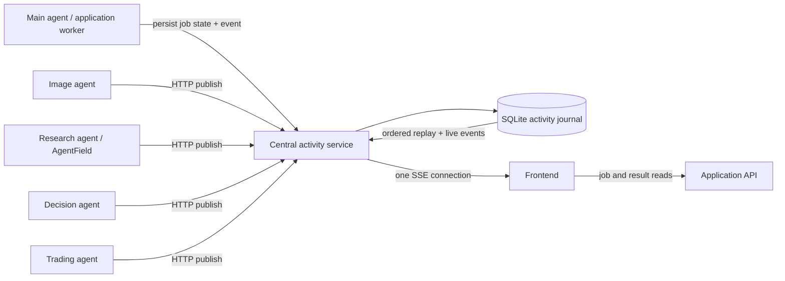

# Central activity stream contract v1.0

**Status: implemented in `activity_server.py`, `activity.py` and `backend/activity.py`.**
The application API mounts the stream using its existing sessions and atomic
job-write hook. The research AgentField node publishes real operation boundaries.
Other agents can use the shared publisher; their detailed steps need wiring.
This is the shared contract for the application backend, frontend and all agent
workstreams. It supplements [Frontend_API_Contract.md](Frontend_API_Contract.md).
The application backend owns the activity service. Each agent owns emitting its
activities. Existing research, decision, trading and image-agent return schemas
stay unchanged. No new message broker is required for the hackathon.

## Architecture and authority



SSE is server-to-browser only. Agents **publish using HTTP POST**, not by writing
to an SSE connection. One central journal serves all producers and subscribers.
The browser uses the same application origin/session as its other API calls;
it never connects directly to AgentField or receives provider/publisher keys.

The application `job_id` is the correlation ID across agents. Research `run_id`,
AgentField execution ID and report IDs are optional references, not substitutes
for `job_id`. An agent finishing a step does not finish the application job.
Only the application worker may emit job lifecycle events, after persisting the
corresponding authoritative state. Research `status: partial` can accompany an
application job that `succeeded`; render both accurately.

## HTTP endpoints

| Method/path | Consumer | Contract |
| --- | --- | --- |
| `GET /api/v1/activity/stream` | Frontend | SSE for all jobs owned by the current session. Optional `job_id` filter; optional `after` replay cursor. |
| `GET /api/v1/activity` | Frontend | JSON history; optional `job_id`, `after`, `limit` (default 100, max 200). Returns `{items, next_cursor, has_more}` inside the standard success envelope. |
| `POST /internal/v1/activity/events` | Agents | Append one validated activity. Requires a job-scoped publisher credential. Not exposed as a browser mutation. |

The stream is shared across agent types. Prefer **one connection per browser
tab** and group events by job and span in the UI. A job-specific view can use the
filter instead; changing filters requires a new stream with its own cursor.
`GET /api/v1/capabilities` advertises `features.activity_stream`; keep it false
until the stream and replay acceptance checks pass. The frontend checks this
before subscribing and uses job polling while it is false.
All reads enforce job ownership on every event. Inaccessible job filters return
404. Recheck session validity while streaming, at least every heartbeat interval;
session expiry/revocation closes the stream. Normal API session rules still apply.

Agent ingestion uses `Authorization: Bearer <publisher_token>`. The application
issues a token bound to an existing job, one producer ID, permitted operations
and an expiry no later than the job's absolute expiry plus 60 seconds. An input
waiting deadline must be considered when setting that expiry. A resumed attempt
gets fresh context. Do not use provider keys or the browser's CSRF token here.
For a local single-user deployment, an opaque random token in a backend-owned
registry is sufficient; no JWT infrastructure is required.

The server derives producer identity and job ownership from that credential;
caller-supplied IDs cannot widen its permissions. Agents cannot create jobs,
publish for other jobs, or emit `job.*` events. The application can append its
own lifecycle events through the same event-store interface without HTTP.

## Producer request

```json
{
  "schema_version": "1.0",
  "event_id": "13f39e40-b878-4c2b-99e8-f86262bb47c4",
  "job_id": "job_demo_1",
  "type": "step.started",
  "operation": "research.search",
  "span_id": "span_search_1",
  "parent_span_id": "span_research_1",
  "attempt": 1,
  "occurred_at": "2026-11-14T08:00:00Z",
  "level": "info",
  "message": "Searching Mercari and Rakuma for Mewtwo V 273/S-P.",
  "data": {
    "provider": "tavily",
    "progress": {"completed": 0, "total": 2, "unit": "queries"},
    "counts": {},
    "references": [],
    "result_status": null,
    "error_code": null
  }
}
```

Required fields are those shown; `parent_span_id` and `occurred_at` may be null.
`event_id` is a producer-generated UUID, stable across retries of the same event.
`span_id` is stable across a step's started/progress/terminal events; a retry uses
the same span and increments `attempt`. Both the step and a nested source/tool
call can have their own spans. `parent_span_id` identifies the logical parent;
it may be delivered later when agents run concurrently.

`operation` is a lowercase namespaced identifier, at most 80 characters, such as
`identify.card`, `research.plan`, `research.search`, `research.inspect`,
`research.compare`, `research.synthesize`, `decision.plan`, `trading.draft` or
`trading.preflight`. New operation names do not require a schema revision.
`level` is `info`, `warning` or `error`. `message` is plain text, at most 500
characters. Render it as text, never injected HTML/Markdown.

`data` is a fixed frontend-safe structure, not arbitrary provider JSON:

| Field | Meaning |
| --- | --- |
| `provider` | Display name/ID or null, never its request configuration. |
| `progress` | `{completed, total, unit}` or null. Nonnegative integers, total nullable; completed cannot exceed a known total. No invented percentages. |
| `counts` | Up to 20 named nonnegative integer counts, e.g. sources, listings, inspected, qualifying. |
| `references` | Up to 20 `{kind, id, url, label}` records. `kind`: listing, research_report, decision, draft, intent, candidate, evidence. IDs/labels nullable; URLs nullable. |
| `result_status` | Domain result status or null, e.g. `partial` or `insufficient_evidence`. It does not change job state. |
| `error_code` | Sanitized stable code or null, not a raw exception. |

Reference URLs are application-relative resource URLs, or canonical HTTPS public
listing URLs validated by the relevant marketplace adapter. Reject credentials,
fragments/query tokens, local filesystem paths and javascript/data URLs. Report
references point to authorized application resources, never raw local log paths.
Counts, costs and timings are emitted only when observed; this initial schema
does not carry model-generated monetary estimates.

Reject unknown fields and payloads larger than 16 KiB with 422/413. Never include
API keys, publisher tokens, cookies, raw prompts, model thought traces, full
provider responses, stack traces or uploaded image bytes. Provider-specific raw
diagnostics and source evidence stay in their existing private journals/artifacts.
The emitter must construct safe messages and the service must validate the
allowlist; redacting known secrets alone is not a sufficient projection.

## Event types

| Type | Meaning |
| --- | --- |
| `job.queued`, `job.started` | Authoritative job accepted/started. Backend only. |
| `job.awaiting_input`, `job.resumed` | Backend persisted questions/resumption. Read the job for questions. |
| `job.cancel_requested` | Cancellation requested, not completed. Backend only. |
| `job.succeeded`, `job.failed`, `job.cancelled` | Backend persisted the actual terminal outcome. |
| `step.started`, `step.progress`, `step.completed`, `step.failed` | Agent activity for one operation/span/attempt. |
| `finding.observed` | Source-backed observation or source count; not a buying recommendation or verification upgrade. |
| `artifact.created` | An authorized result reference is now saved and readable. |
| `activity.warning` | Coverage limit, provider limitation or activity delivery gap. |

Job lifecycle events additionally carry `data.job = {state, revision, stage}`,
validated against the backend's persisted Job. Only these events may include
that field. `revision` is the job revision, not a count of progress events.
`data.references` can identify a saved result. No raw ResearchReport is embedded
in SSE; the frontend reads the report resource on an artifact/terminal event.

An agent emits `step.failed` for a failed attempt, even when fallback later
succeeds. A later attempt can complete the same span. The UI retains failed
attempts rather than erasing them. Out-of-order cross-agent arrival is possible;
the UI groups by span/attempt and never regresses a completed attempt to started.
The stream carries operations, evidence and concise explanations, not private
chain-of-thought or model token streaming.

## Acknowledgment, ordering and idempotency

The server validates, commits the event and **then** acknowledges/broadcasts.
201 returns the standard envelope containing
`{event_id, cursor, recorded_at, producer_id, duplicate: false}`.
Repeating the same producer/event ID and canonical payload returns 200 with the
same cursor and `duplicate: true`. A different payload with the same ID returns
409 `EVENT_ID_CONFLICT`. A failed request must never receive a success receipt.
No separate Idempotency-Key header is needed on this internal endpoint.

Persist server-assigned `cursor`, `recorded_at` (UTC), `producer_id` and the
validated producer payload. The cursor is an opaque string representing a
monotonically increasing database sequence. It defines **commit order**, not
the producer's wall-clock or causal execution order. Never reorder the journal
using `occurred_at`; use parent/span relationships for the visual hierarchy.

The append-only activity table is additive to the application SQLite database
at `data/collection.sqlite3`, with indexes on cursor, job/cursor and unique
producer/event ID. No change to existing collection tables. Store a canonical
payload hash for deduplication. Only the central backend writes these rows.
The application worker persists a job transition and its corresponding `job.*`
event in the **same transaction**. This prevents a terminal job with no terminal
event, without a second queue/outbox service. AgentField's internal workflow
store is separate and is not the browser event store.

After terminal job state, reject new agent activities with 409
`JOB_ALREADY_TERMINAL`; acknowledge an already committed identical retry before
this check. The backend cancels/joins child work before finalizing where possible.
Late private diagnostics can remain in agent journals; they must not reopen a job.

## SSE wire format and reconnects

Headers: `Content-Type: text/event-stream; charset=utf-8`,
`Cache-Control: no-cache, no-transform`, `X-Accel-Buffering: no`.
Disable proxy response buffering/compression that would delay frames. Flush
after every event. Set `retry: 2000` when opening the stream.

```text
id: 1842
event: activity
data: {"schema_version":"1.0","event_id":"13f39e40-b878-4c2b-99e8-f86262bb47c4","cursor":"1842","producer_id":"pokescout-research","job_id":"job_demo_1","type":"step.started","operation":"research.search","span_id":"span_search_1","parent_span_id":"span_research_1","attempt":1,"occurred_at":"2026-11-14T08:00:00Z","recorded_at":"2026-11-14T08:00:00.050Z","level":"info","message":"Searching Mercari and Rakuma for Mewtwo V 273/S-P.","data":{"provider":"tavily","progress":{"completed":0,"total":2,"unit":"queries"},"counts":{},"references":[],"result_status":null,"error_code":null}}

```

All persisted events use SSE `event: activity`; their domain type is inside JSON.
The SSE ID and JSON cursor are identical. Serialize each JSON event on one `data`
line (escape internal newlines). A blank line terminates the frame. Send
`: heartbeat\n\n` after 15 seconds without an event; heartbeats have no ID and
are not persisted. The stream stays open after any individual job completes.

Reconnect using native EventSource `Last-Event-ID`. For a reload/new connection,
the frontend may persist its last **processed** cursor in sessionStorage and
send `?after=<cursor>`. Header takes precedence if both are present. Partition
stored cursors by session and filter; clear them on logout. Deduplicate rendered
events by event ID; replay can repeat already processed events.
If applying an event fails, close and recreate the connection from the last
successfully applied cursor; the browser's automatic last-received ID is not an
application render/transaction acknowledgment.

No cursor means replay all retained visible events, then tail live events.
Read persisted events in cursor order in batches of 100. Keep only one batch
per subscriber; never load the whole journal into RAM. The same durable
read-after-cursor loop handles replay and live delivery, so a publish during
the replay-to-live transition cannot fall into an in-memory subscription gap.
For the single-process hackathon backend, poll the SQLite journal every 250 ms
when idle. This avoids Redis, per-producer streaming protocols and unbounded
subscriber queues. Future replicas must share a store/notification mechanism;
independent SQLite files are not a shared event bus.

Retention is seven days for completed jobs. Purge a contiguous cursor prefix
only when all affected jobs are terminal and past retention; active/waiting jobs
can postpone pruning. Keep a durable retention floor. Bound ingestion to 10000
events per job and ten events/second per producer, with bursts of 20; return
429 and Retry-After. Coalesce rapid progress updates at the producer. Keep
terminal backend events exempt from the per-producer activity cap.

If a supplied cursor predates retained history, is from the future, or cannot
be parsed, emit `event: stream.reset` **without an SSE ID**, with data
`{reason, resume_after, history_url}`, then close. `resume_after` is the server's
current authorized high-water cursor; reason is `cursor_expired`,
`cursor_invalid` or `cursor_ahead`. The frontend must close that EventSource,
refresh job snapshots/history, and explicitly open a new one after that cursor.
Do not treat missing history as a failed job. Control events do not advance the
durable cursor. Native automatic reconnect alone cannot repair an invalid cursor.

A slow/disconnected reader never blocks publishers or cancels a job. Time out
an individual blocked stream write after ten seconds and close it; reconnect
replays from its cursor. SSE gives replay of **acknowledged** events, not exactly
once UI updates or permission to repeat an agent operation.

## Frontend hookup

```javascript
const stream = new EventSource('/api/v1/activity/stream');
stream.addEventListener('activity', ({ data, lastEventId }) => {
  const event = JSON.parse(data);
  // Apply idempotently by event_id, grouping by job_id/span_id/attempt.
  // Only after applying, save lastEventId for this session/filter.
  // On artifact/job events, fetch the authorized result/job resource.
});
stream.addEventListener('stream.reset', ({ data }) => {
  stream.close();
  // Refresh snapshots/history, then open a new stream after resume_after.
});
// onerror marks the connection reconnecting, not the application job failed.
// Close on logout/unmount. Do not close the session-wide stream on job completion.
```

Use status cards for agents, nested rows for operations, source links for
observations and result cards for artifacts. Show factual counts and indeterminate
progress where total work is unknown. A provider limitation is a warning, a
failed attempt is visible, and a partial result keeps its partial badge.
The authoritative Job API remains the fallback: poll active jobs every two
seconds when SSE is unavailable. Do not run both full-speed unnecessarily.

## Agent integration and failure behavior

The backend passes an internal `activity_context` to an agent invocation:
`{job_id, producer_id, parent_span_id, publish_url, publisher_token}`.
It is separate from domain inputs and never returned to the frontend. For
AgentField, the root Python client accepts keyword-only `activity_context` and
encodes it in the private `X-PokeScout-Activity` header on the direct node call.
ASGI middleware removes this header before SDK request handling and binds a
context-local emitter. The body remains `{"request": request}`; credentials
never enter SDK reasoner arguments. Control-plane header forwarding is not
implemented or assumed; use the shared Python client for activity-enabled calls.

Every agent uses the same publisher interface,
`ActivityEmitter.emit(type, operation, message, span_id=..., data=..., ...)` in a shared
`activity.py` module. It constructs the UUID once, validates/projects the safe
payload and POSTs it. Retry only connection errors, 429 and 5xx, at most twice,
with the same UUID/body, at most two seconds of request time per attempt and
bounded Retry-After within the job deadline. Do not retry 4xx validation/auth
failures. Publication failure is recorded as a private logger warning; the first
implementation does not persist a retry spool or publish recovery summaries.
It does not repeat provider work.
Events never acknowledged by the service may be absent from the central stream.

Agents emit before and after actual boundaries, not simulated timed messages.
Research maps planning, each Tavily search, source inspection, fallback extraction,
comparison and synthesis to spans. Source URLs/counts are emitted when known.
Persist the report before `artifact.created`. A step failure can be followed by
a fallback step; only the orchestrator decides the job's final state. Logging
existing raw runtime.record() payloads directly into SSE is forbidden.

## Implementation order and acceptance

1. Backend: additive SQLite event journal, validation/idempotent append, internal
   publisher authorization, JSON history and SSE replay/tail endpoints.
2. Main application: job creation/context, atomic lifecycle events, safe result
   references; do not invent a second central run/job manager inside agents.
3. Shared Python publisher and one real research integration; other agents add
   the same emitter without changing their domain return schemas.
4. Frontend: one EventSource, span timeline, reconnect/replay and polling fallback.

Acceptance: two different agents publish into one job and appear in commit order;
a reconnect replays missed events without duplicate cards; a lost POST receipt
retries into one event; a job/producer token cannot publish for another job;
a second session cannot read another session's events; malformed/oversized
payloads are rejected; a partial research result is not mislabeled complete;
failed/slow SSE and ingestion do not restart agent work; terminal state and event
commit atomically; restart preserves acknowledged history; expired cursors reset
explicitly; public activity never exposes credentials, raw prompts or local paths.

Reference: [WHATWG Server-sent events](https://html.spec.whatwg.org/multipage/server-sent-events.html).
The transport tests cover two producers, live delivery, reconnect, heartbeat,
session revocation, replay, idempotency, isolation, validation and atomic rollback.
The frontend timeline component remains frontend work.

## Run and integrate

From the repository root, use Python 3.12 and the experiment virtual environment:

```powershell
.\experiments\sc\.venv\Scripts\python.exe -m pip install -r requirements-activity.txt
# Standalone activity transport, for local experiments:
.\experiments\sc\.venv\Scripts\python.exe -X utf8 activity_server.py
# Separate terminal; AgentField research service must already be running:
.\experiments\sc\.venv\Scripts\python.exe -X utf8 activity_demo.py --research
```

The standalone service binds `127.0.0.1:18082`. Its `/api/v1/session` creates a
local demonstration session; it is an activity-only service. For the application
API, `backend.app.create_app()` mounts the same router and uses `api_sessions`.
It mirrors existing jobs using `job.snapshot` and appends future job lifecycle
events in the existing job transaction. It does not create another worker queue.
The internal ingestion route uses publisher bearer authentication, independently
of browser cookies/CSRF.

For application port 8000, set
`ACTIVITY_PUBLISH_URL=http://127.0.0.1:8000/internal/v1/activity/events` in **both**
the application and research-node environments before starting them. Both must
use the same database. The default URL remains port 18082 for the experiment.
Backend workers automatically pass context to the canonical research client.
Custom injected research adapters retain their existing one-argument interface.

Frontend (same origin, after initializing `/api/v1/session`):

```javascript
const stream = new EventSource('/api/v1/activity/stream', {withCredentials: true});
stream.addEventListener('activity', event => {
  const activity = JSON.parse(event.data);
  // Upsert by event_id; group by job_id, span_id and parent_span_id.
  renderActivity(activity);
});
stream.addEventListener('stream.reset', () => {
  stream.close();
  // Reload authorized history, then reconnect using its next_cursor as ?after=.
  reloadActivityHistory();
});
```

Other Python agents receive a backend-minted `ActivityContext` (never from the
browser) and publish through:

```python
from activity import ActivityEmitter
async with ActivityEmitter(context) as activity:
    activity.emit('step.started', 'identify.card', 'Inspecting the uploaded card.',
                  span_id=span_id, parent_span_id=context.parent_span_id)
    # Actual agent work; emit completed/failed afterwards using the same span_id.
```

The backend mints this using `app.state.activity_store.issue_context(job_id,
producer_id, ['identify.*'], publish_url=..., parent_span_id=job_id)` after the
job is durably created. Never log the context header or publisher token.
